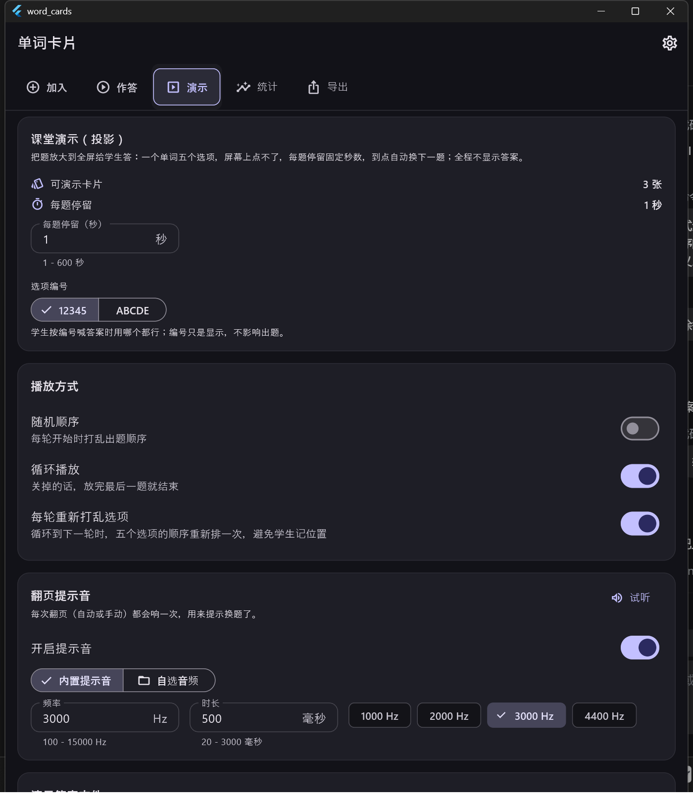
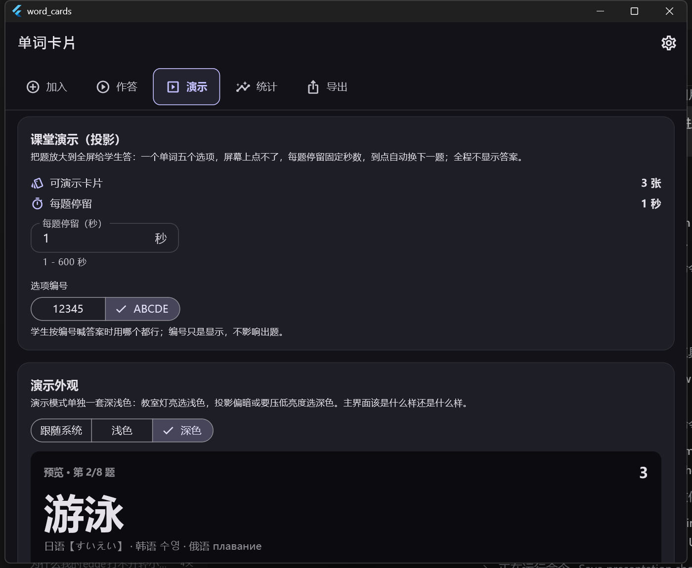

# 单词卡片（word_cards）

[](https://github.com/Minehara-RI/word_cards/actions/workflows/ci.yml)
[](LICENSE)


AI 驱动的跨平台单词学习应用。输入单词，用 AI 生成「正确释义 + 4 个有混淆性的干扰项」，
然后做五选一快速测验；**所有数据只存在本机**，不联网、不上传、不需要账号。

本地数据库用的是 **Anki 的原生格式**（SQLite / collection.anki2 / schema 11）：
库文件可以直接用 Anki 打开，复习历史写在 Anki 的 revlog 里，导出页还能生成一份
.anki2 交给 Anki。细节见 [docs/Anki数据库与主界面.md](docs/Anki数据库与主界面.md)。

当前进度：阶段一（手动导入 + 移动端测验 + 卡片管理）、阶段二（Windows 桌面端适配 +
数字键 1-5 键盘作答）、阶段三（API 直连生成）、阶段四（课堂投影）、阶段五（间隔重复 /
统计 / 导入导出）**全部完成**，**收尾与打包也已完成** —— 手机 APK 和 Windows 安装包
都能一条命令出（见 [打包与发布](#打包与发布)）。

最近几轮加的东西：**多语言（英/法/日/韩/俄）**、**卡片标签**、**单一当前卡组**、
**FSRS-6 复习算法（可选，和原有算法互不干扰）**、**演示另开一个强制最大化的窗口**、
**统一无衬线字体**、**所有设定都会被记住**、**作答范围**（不用 FSRS 时默认出当前卡组的
全部词，并且可以按标签筛词 —— 多选取「与」，只在「原有算法」下生效，开着 FSRS 时
这排筛选整块不画）、**桌面端数字键作答**，以及**手机端只留四个界面**
（课堂投影只在桌面端出现，手机上连入口都没有），以及**阶段三：API 直连生成**
（多提供商预设、缓存去重、失败降级回模式 A）。细节见
[docs/新增功能-语言·标签·FSRS·演示窗口.md](docs/新增功能-语言·标签·FSRS·演示窗口.md)、
[docs/阶段二完成说明.md](docs/阶段二完成说明.md) 和
[docs/阶段三完成说明.md](docs/阶段三完成说明.md)。

## 主界面

上方一排入口，**桌面端五个：加入 / 作答 / 演示 / 统计 / 导出**；
**手机端只有四个：加入 / 作答 / 统计 / 导出**。

课堂投影是「一台电脑接投影仪」的场景：手机既开不了独立的演示窗口，也没法把画面
投给一屋子人，所以「演示」整页不给 —— 入口、页面、以及设置页里那套演示深浅色
一起不出现。这个判断只有一处（`home_shell.dart` 的 `visibleHomeTabs()`）。

| 作答 | 加入 | 演示设置 |
|---|---|---|
|  |  |  |

| 演示进行时（12345） | 演示进行时（ABCDE） | 统计 |
|---|---|---|
|  |  |  |

| 演示答案文件设置 | 导出 |
|---|---|
|  |  |

新增的几块界面：

| 演示另开窗口并最大化 | 演示设置与外观预览 | 作答页内联参数 + FSRS |
|---|---|---|
|  |  |  |

| 加入页：卡组 / 标签 / 语言 | 导入页：整批标签与卡组选择 | 设置：外观与语言字体 | 卡片列表：语言与标签 |
|---|---|---|---|
|  |  |  |  |

作答范围（默认「全部」+ 标签筛选）就在作答页的「本轮设置」里：

| 作答范围：默认全部 + 标签筛选 |
|---|
|  |

桌面端的作答页接了键盘，题目下方会按本题选项数给出提示：

| 桌面端键盘作答 |
|---|
|  |

## 测验规则（阶段一）

### 每题都限时（硬规则，不能关）

- 每道题都有作答倒计时，秒数**在作答页直接填数字**（1-600）；
  不给预设档位，也不给「不限时」
- 到点还没作答：判**超时**，记一条错题（timed_out，反应时间等于限时），**自动进入下一题**
- 作答后也会自动翻页；超时之后这一题再点选项也不会生效，不会重复记账
- 界面顶部一直显示「剩余 N 秒（超时自动下一题）」，剩余不足 30% 会变红
- 成绩单会单独标出「其中 N 题超时未作答」，错题清单里用计时器图标区分

### 桌面端：数字键直接作答（阶段二）

Windows / macOS / Linux 上作答页不用碰鼠标：

| 键 | 作用 |
|---|---|
| `1`-`5` 或小键盘 `1`-`5` | 选第 N 个选项（选项左边的角标就是键位） |
| `A`-`E` | 同上，习惯左手按字母的可以用这一套 |
| `Enter`（含小键盘回车） | 答完进入下一题；**没作答时按它什么都不做**，免得手滑被判错 |
| `Esc` | 退出本轮，回到进来那一页（答过的都已经落库） |

- 只有桌面端接键盘（判定走 `PlatformTarget.isDesktop`）；手机上不装监听
- 只认「按下」这一次，按住 Enter 不放不会连着跳题
- 本题选项比按键少时，多出来的键被吃掉，不会漏给上层的焦点导航
- 题目下方有一行贴合本题选项数的提示：4 个选项就写「键盘：1-4 或 A-D 选答」

课堂投影模式按**同一原则**实现：每个单词一个限时，到点直接切下一个，
不给「一直停在这一页」的选项。

### 正误什么时候显示（三选一）

| 模式 | 答题过程中 | 结束后 |
|---|---|---|
| **立即显示**（默认） | 马上标绿/标红，并给出正确释义 | 列出答错的单词 |
| **统一显示** | 不露任何对错，只中性标出「你选了这一项」，右上角连实时比分都隐藏 | **逐题回顾**：每题显示你选了什么、正确答案是什么 |
| **不显示** | 同上，也不显示实时比分 | **只给总分**，不列题目与答案 |

「统一显示」下刻意隐藏了实时「答对 N 题」计数，因为它会间接暴露上一题做对没有。
三种模式共用同一套答题与计时逻辑，只是「什么时候把答案说出来」不同。

| 统一显示·作答中 | 统一显示·逐题回顾 | 不显示·只看总分 |
|---|---|---|
|  |  |  |

## 演示模式（课堂投影）

演示**不是背诵，是用来答题的**：和作答页看到的是同一种题（一个单词 + 五个选项），
只是放大到全屏，而且**屏幕上点不了** —— 学生口头作答，节奏由每道题的停留限时控制。
**全程不显示答案**。

### 桌面端：另开一个强制最大化的窗口

点「开始演示」不会把主界面顶掉，而是**新开一个独立的系统窗口**专门放演示画面，
**并强制最大化、不让缩回小窗**（被还原的话两秒内自动再最大化回去）：

- 主窗口仍然是唯一「真相来源」：它算题、控节奏、写答案 txt，
  每秒把当前一帧推给演示窗口；演示窗口只负责画画面
- 演示窗口里的空格 / 左右方向键 / Esc 会回传给主窗口处理
- 关上演示窗口 == 停止演示：主窗口会停掉这一轮并照样写出答案 txt
- 独立窗口开不出来时（插件不可用、测试环境）自动退回应用内全屏页，功能一样不少
- **手机端没有这一页**：整个「演示」只在桌面端出现，下面这些设置手机上都不会看到

- 每道题一个停留限时（**只给输入框，没有预设档位**），**到点自动换下一题**；
  不循环时放完最后一题就结束
- 选项编号可以选 **12345 或 ABCDE**
- 可设随机顺序、循环播放，以及**每轮重新打乱选项**（循环到下一轮时重新排一次，防止学生记位置）
- 全屏播放：空格暂停/继续、左右方向键上一题/下一题、Esc 退出
- **翻页提示音可以换**：默认 3000 Hz / 0.5 秒的正弦波（频率与时长都能改），
  也可以用系统文件选择器挑自己的音频；关掉开关就完全不创建播放器，
  自选文件读不到时自动退回内置提示音

### 演示结束会写一份答案 txt

- 结束时（或者中途按 Esc 退出时）把这一轮出过的题和答案写成一份 txt，
  文件名是 `演示答案_时间_卡组名.txt`
- **两种输出模式**：
  - `只含选项`：一行一题，只写正确答案那一项，适合照着核对
  - `单词 + 义项`：写单词、音标和正确答案，适合发给学生
- 输出目录可以自定义（直接手填路径，桌面端还能点「选择目录…」），
  默认是文档目录下的 `word_cards_answers`
- 演示是纯展示：**不写任何答题记录**，也不会写 Anki 的 revlog，卡片掌握度不动

## 数据库

| 层 | 内容 |
|---|---|
| Anki 原生表 | col / notes / cards / revlog / graves（完全按 Anki schema 11 建） |
| 应用扩展表 | wc_card_ids / wc_deck_ids / wc_card_stats / wc_card_fsrs / wc_answer_log / wc_settings（wc_ 前缀，Anki 会忽略） |

- 一张卡片 = 1 条 notes + 1 条 cards，字段按「单词 / 释义 / 音标 / 例句 / 词性 / 备注 / 干扰项」
  用 \x1f 拼进 flds
- csum 用 sha1(sfld) 前 8 位十六进制，和 Anki 算法一致
- 每次作答会同时写 Anki 的 revlog 和应用自己的 wc_answer_log
- 启动时会自动把旧的 sembast 库（word_cards.db）一次性迁移过来
- **标签与语言都存在 Anki 的 notes.tags 里**：来源（手动导入 / API 生成）+ 语言（`lang::ja`）
  + 用户自己的标签，所以拿 Anki 打开也能一眼看出这张卡是什么语言、打过什么标签
- **FSRS 的记忆状态单独存在 wc_card_fsrs 里**，和掌握度 / 正确率 / ease 那套完全分开：
  开着 FSRS 只写这张表，换回原有算法时这张表原样留着，两边互不干扰

## 两种 AI 模式

- **模式 A：网页聊天导入（阶段一已实现）**
  应用内置 3 套 Prompt 模板，一键复制粘贴到任意网页版大模型；
  把返回的 JSON 整段粘回应用即可。**零成本、不用配置 API、完全不联网。**
  解析器对代码块包裹、前后闲聊、中英文字段名混用、尾随逗号、全角标点、
  未转义换行都做了容错；出错时会明确告诉你「第 2 张卡片：缺少 definition（正确释义）字段」。
- **模式 B：API 直连（阶段三已实现）**
  在「设置 → AI 生成（模式 B）」里挑一家提供商（DeepSeek / OpenAI / Moonshot Kimi /
  智谱 GLM / 通义千问 / 硅基流动 / OpenRouter，以及本地的 Ollama 与 LM Studio，
  也可以填任意 OpenAI 兼容地址），填地址、模型、密钥即可。
  请求只用 `POST {base}/chat/completions` 一件事，所以任何 OpenAI 兼容服务都能用。
  两种模式产出同样的数据结构，入库后无差别使用（只在 `source` 字段上区分）。

  三条硬规则：
  **同样的 Prompt 在缓存期内不重复请求**（存 `wc_api_cache` 表，缓存时长可改，0 = 不缓存）；
  **失败一定说清下一步**（超时 / 401 / 429 / 5xx / 返回不是 JSON 各有各的说法，
  400 还会把服务端自己的错误信息带出来）；
  **失败能一键降级回模式 A**（原文已经填进粘贴框，可以直接手改，也可以切回网页聊天导入）。
  调用次数与 token 用量记在本机设置里，设置页有「测试连接」和用量统计。

| 导入页：切到 API 直连 | 设置：AI 生成（模式 B） |
|---|---|
|  |  |

## 目录结构

```
lib/
  main.dart                      入口：打开 Anki 库、迁移旧数据、把仓库注入 Riverpod
  src/
    domain/                      纯 Dart 领域层：模型 + 仓库接口
      models/                    WordCard / AnswerRecord / AppSettings / Deck / CardSource
      repositories.dart          仓库接口（实现在 data/）
    data/
      anki/                      Anki 数据库：建表、col 配置、五个仓库实现、旧库迁移
      audio/beep_player.dart     翻页提示音（内置正弦波可调，或用户自选音频）
      export/export_service.dart JSON / CSV / Anki 库导出
      local/                     旧的 sembast 实现，只留给迁移用
      ai/prompt_templates.dart   内置 Prompt 模板
      ai/api_client.dart         OpenAI 兼容客户端（超时 / 错误分类 / 中文不乱码）
      ai/ai_providers.dart       多提供商预设表 + 地址归一化
      ai/generation_service.dart 生成编排：模板 → 缓存 → 请求 → 容错解析 → 写缓存
      anki/anki_api_cache_repository.dart  生成缓存（wc_api_cache 表）
      import/card_parser.dart    容错 JSON 解析器
      import/import_service.dart 去重 / 补干扰项 / 入库
    logic/                       与平台无关的纯函数：出题、评分、统计、WAV 生成
      fsrs.dart                  FSRS-6：包一层官方 dart-fsrs，做状态映射 / 评分映射 / 复习队列
    state/                       Riverpod providers、测验状态机、演示状态机
    ui/                          UI 层（唯一允许出现平台判断的地方）
      platform_target.dart       mobile / desktop 判定（含「能不能开演示窗口」）
      quiz_keys.dart             作答页的按键映射（纯函数：数字 / 字母 / Enter / Esc）
      fonts.dart                 全局无衬线字体栈 + 演示模式大字号
      presentation/              演示画面：帧数据结构、公共画面、独立窗口、Win32 最大化
      widgets/                   通用小组件（卡组选择、数字输入框…）
      pages/                     主壳（入口按平台给：桌面 5 个 / 手机 4 个）
                                  + 五个页面 + 测验 / 全屏演示 / 导入 / 卡片列表 / 设置
test/                            单元与 widget 测试（239 个）
integration_test/                真机（Windows 窗口）端到端验收测试
scripts/                         构建与体检脚本（见「打包与发布」）
  env.ps1                        工具链路径，唯一需要按机器改的文件
  verify.ps1 / build_apk.ps1 / build_windows.ps1 / build_installer.ps1 / build_release.ps1
packaging/
  word_cards.iss                 Windows 安装包定义（Inno Setup 6）
dist/                            发布产物（不入版本库）
```

架构约束：**逻辑层与数据层不含任何平台判断**，桌面特有功能只在 UI 层条件性暴露。

## 开发命令

环境（Flutter / JDK / Android SDK / VS 生成工具）的安装位置与踩坑记录见
[docs/环境与工具链.md](docs/环境与工具链.md)，阶段一验收细节见
[docs/阶段一完成说明.md](docs/阶段一完成说明.md)。

```powershell
$env:JAVA_HOME='D:\ProgramData\jdk-21'
$env:ANDROID_HOME='D:\ProgramData\android-sdk'
$env:PUB_CACHE='D:\ProgramData\pub-cache'
$env:GRADLE_USER_HOME='D:\ProgramData\gradle-home'
Set-Location 'D:\Documents\GitHub_workspace\word_cards'

flutter analyze
flutter test                                              # 单元 + widget 测试（239 个）
flutter test integration_test/app_test.dart -d windows    # 真机端到端
flutter build windows --debug
flutter build apk --debug
```

> 注意：跑完 integration_test 后，build\windows\...\word_cards.exe 会被换成测试宿主，
> 想再手动打开应用，要先重新 flutter build windows 一次。

需要外网的命令前面加代理：HTTPS_PROXY / HTTP_PROXY 指向 http://127.0.0.1:7897。
除了 flutter pub get，**Android 构建也要**：sqlite3 的原生库是构建时下载的
（`Target build_hooks failed: Building native assets failed` 就是没走代理的表现；
清过 `.dart_tool\hooks_runner` 之后第一次 `flutter build apk` 一定会遇到）。

## 打包与发布

一条命令出齐 APK + Windows 免安装包 + Windows 安装包（产物都在 `dist\`）：

```powershell
pwsh -File scripts\build_release.ps1
```

| 产物 | 给谁 |
|---|---|
| `dist\word_cards-1.0.0.apk` | 安卓手机（58 MB，通用包，含三个 ABI） |
| `dist\word_cards-setup-1.0.0.exe` | Windows 电脑，双击安装（按用户装，不弹 UAC） |
| `dist\word_cards-win-x64.zip` | 不想装东西的人，解压直接跑 |

也可以单跑：`scripts\verify.ps1`（analyze + 测试 + 集成测试）、
`build_apk.ps1`、`build_windows.ps1`、`build_installer.ps1`。
版本号由 `pubspec.yaml` 的 `version:` 决定，不用手改。
工具链路径集中在 `scripts\env.ps1`；Gradle 代理、签名、产物命名这些坑
写在 [docs/打包与发布.md](docs/打包与发布.md)。

## 文档

| 文档 | 内容 |
|---|---|
| [Anki数据库与主界面.md](docs/Anki数据库与主界面.md) | 库结构、schema 11、主界面入口（桌面五个 / 手机四个）、启动迁移、已知坑 |
| [新增功能-语言·标签·FSRS·演示窗口.md](docs/新增功能-语言·标签·FSRS·演示窗口.md) | 五种语言 / 卡片标签 / 单一当前卡组 / FSRS-6 / 独立演示窗口 / 统一字体 / 作答范围与标签筛选 |
| [阶段二完成说明.md](docs/阶段二完成说明.md) | 阶段二（桌面数字键作答）的按键表、平台开关、取舍与验收 |
| [阶段三完成说明.md](docs/阶段三完成说明.md) | 阶段三（API 直连）的提供商表、错误分类、缓存策略、测试清单与验收 |
| [FSRS参数优化.md](docs/FSRS参数优化.md) | FSRS 参数自优化的调研存档（Anki 怎么做的、三条实现路线、将来接入的设计草案） |
| [阶段一完成说明.md](docs/阶段一完成说明.md) | 阶段一的验收记录（历史文档，开头列了后来被取代的写法） |
| [打包与发布.md](docs/打包与发布.md) | 出 APK / Windows 安装包：脚本用法、产物清单、签名、Gradle 代理坑 |
| [环境与工具链.md](docs/环境与工具链.md) | Flutter / JDK / Android SDK / VS 生成工具的安装位置与踩坑 |

`docs/screenshots/` 放 README 引用的截图，编号 01-32（19 是空号，不影响引用；
31 / 32 是阶段三的 API 直连与设置页）。

## 路线图

- [x] **阶段一** 手动导入模式 + 移动端测验 + 卡片管理
- [x] **阶段二** Windows 桌面端适配 + 数字键 1-5 键盘作答（只有桌面端接键盘，
  数字 / 字母 / Enter / Esc 四类键，屏幕上给按键提示，见
  [docs/阶段二完成说明.md](docs/阶段二完成说明.md)）
- [x] **阶段三** API 直连生成（多提供商预设、按 `apiCacheHours` 缓存去重、
  失败分类 + 一键降级回模式 A、本机用量统计，见
  [docs/阶段三完成说明.md](docs/阶段三完成说明.md)）
- [x] **阶段四** 课堂投影模式（独立最大化窗口、每词限时自动翻页、播放控制、可换翻页提示音）
- [~] **阶段五** 间隔重复：已用**官方 dart-fsrs 包**实现 FSRS-6 调度（可选、与原有算法并存），
  统计与导入导出也已就位；SM-2 那套老算法保留不动
- [x] **收尾**：FSRS 的参数集**用 dart-fsrs 包自带那套**（`kFsrs6DefaultParameters`）——
  不自己训练、也不抄别的应用的参数。经评估，参数自优化是 2-3 周的独立工程，
  且当前数据量远不够训练，因此不做（理由见
  [docs/FSRS参数优化.md](docs/FSRS参数优化.md)）。
- [x] **打包**：`scripts\build_release.ps1` 一条命令出 Android APK +
  Windows 免安装包 + Windows 安装包，见 [docs/打包与发布.md](docs/打包与发布.md)

### 上一份「要补的东西」清单（阶段三，已做完）

2026-10 整理时逐项核对代码留下的那份清单，阶段三已经照着做完：

- 请求构建 → `lib/src/data/ai/api_client.dart`（OpenAI 兼容，只用
  `POST {base}/chat/completions`；超时、401/403、429、5xx、非 JSON、空内容
  各有各的错误类型与「下一步」文案）
- 响应喂给现有的容错解析器 → `lib/src/data/ai/generation_service.dart` 里
  `CardParser().parse(...)`，解析器一个字都没改
- 按 `apiCacheHours` 缓存去重 → 新表 `wc_api_cache`，缓存键是
  「地址 + 模型 + 最终 Prompt」的 sha256；命中缓存不算调用次数、不计费
- 失败降级 → 「加入」页的结果条：原因 + 下一步 + 「改用网页聊天导入」按钮，
  原文照样填进粘贴框可以手改
- token 数写回设置 → `AppSettings.addApiUsage()`，设置页显示调用次数 /
  输入输出 token / 估算成本，可一键重置

至此路线图上五条阶段 + 收尾 + 打包全部做完。真要再往下走，方向有两个：

1. **FSRS 参数自优化** —— 目前数据量还远不够（门槛是几百条复习记录，
   现在库里只有 3 条），等真实用上几个月、记录攒够了再做；
   调研结论、三条实现路线与设计草案都记在 [docs/FSRS参数优化.md](docs/FSRS参数优化.md)；
2. **发布签名** —— APK 目前是 debug 签名，上架前需要换成自己的 keystore，
   步骤见 [docs/打包与发布.md](docs/打包与发布.md)。

## 参与 / 许可

- 想改代码：[CONTRIBUTING.md](CONTRIBUTING.md)（环境、提交前要过的门、分层约定）；
- 发现安全问题：[SECURITY.md](SECURITY.md)（**不要开公开 Issue**，走私密漏洞报告）；
- 版本变更：[CHANGELOG.md](CHANGELOG.md)。

以 [MIT 许可证](LICENSE) 发布，© 2026 Minehara-RI。

> 第三方依赖各自遵循自己的许可证，见 `flutter pub deps` 或各自的 pubspec。
> 本项目的界面文案与文档为中文。
