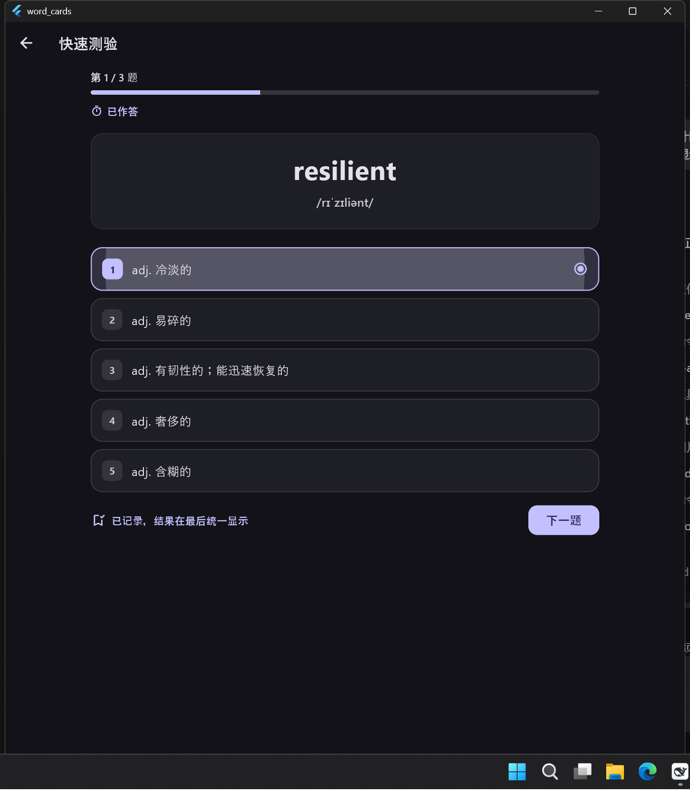
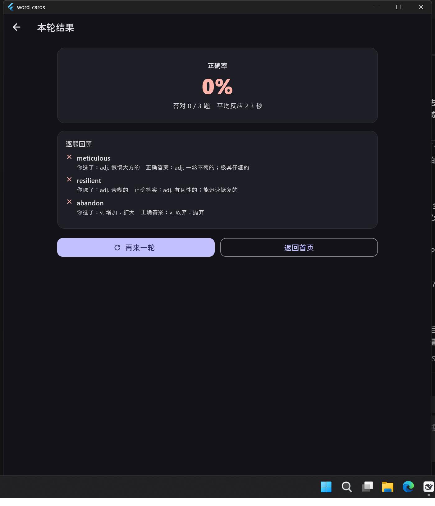
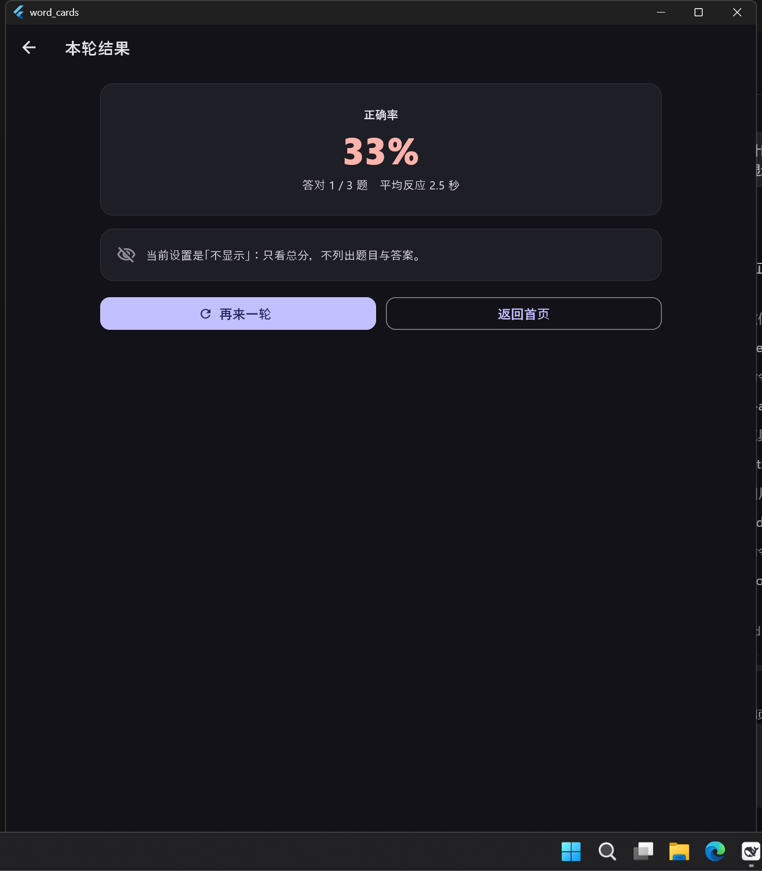

# 使用指南

这份文档讲每个页面怎么用、有哪些规则、以及设置都存在哪。
算法与存储的实现细节分别在 [复习算法](复习算法.md) 与 [存储格式](存储格式.md)。

## 主界面

上方一排入口。**桌面端五个：加入 / 作答 / 演示 / 统计 / 导出**；
**手机端四个：加入 / 作答 / 统计 / 导出**。

课堂投影是「一台电脑接投影仪」的场景，手机不做投屏，所以「演示」整页不给 ——
入口、页面、以及设置页里那套演示深浅色一起不出现。

应用会记住上次停在哪个页面；在手机上如果记住的是「演示」，打开时会退回作答页。

## 加入：把词放进词库

### 手动添加一张

填单词、释义、音标、词性、例句、备注与干扰项。几条规则：

- **干扰项不足 4 个会自动补齐** —— 从同词库其它卡片的正确释义里借，凑满 5 个选项；
- 遇到同名卡片会提示，并可以选择用新内容更新它（不会多出一行）；
- 加入页顶部有「当前卡组」栏，也可以就地改语言、打标签。

### 网页聊天导入（模式 A）

不用配置 API、完全不联网：把应用内置的 Prompt 模板复制到任意网页版大模型，
把返回的 JSON 整段粘回应用即可。

- **三套模板**随时切换，选择会被记住；
- **粘贴即实时校验**，右上角立刻显示解析结果，导入前能预览每张卡片；
- 导入报告会分开说「成功 N 张」「跳过重复 N 张」「第 M 张缺什么字段」。

因为大模型不会老老实实只输出 JSON，解析器做了这些容错：

| 情况 | 处理 |
|---|---|
| 包着 Markdown 代码块、带 BOM 或零宽字符 | 剥掉 |
| 前后有「好的，下面是你要的卡片：」「还需要别的吗？」 | 截出中间那段 JSON |
| 字段名中英文混用 | 单词侧认 word / term / text / 单词 / 词 / headword，释义侧认 definition / meaning / answer / correct / 释义 / 意思 / 中文释义 |
| 结构是顶层对象 / 顶层数组 / 包一层 `cards`·`data`·`items`·`结果` | 都认 |
| 只给了 `options` 加 `answerIndex` | 还原出正确项，并把其余选项当干扰项 |
| 尾随逗号、`//` 与 `/* */` 注释、全角逗号冒号、中文引号、字符串里未转义的换行 | 语法修复 |

错误一定说得具体：「第 2 张卡片：缺少 definition（正确释义）字段」；
整段语法错误会给出「第 N 行第 M 列附近」并附上下文片段。
修复只动字符串**外部**的结构字符，所以释义里的中文标点不会被误伤。

入库时还会：批内去重（同名单词只留第一张）并提醒；与本地已有卡片比对，
默认跳过重复、可选择覆盖；**部分失败不影响其余**，好的先入库，坏的逐条报告。

### API 直连（模式 B）

先在「设置 → AI 生成」里挑一家提供商、填地址与模型、粘贴密钥，点「测试连接」确认。
之后在加入页顶部把分段按钮切到「API 直连」，输入单词点「生成卡片」即可 ——
返回的 JSON 会直接填进原来那个粘贴框，后面的校验、去重、补干扰项、入库全部复用模式 A 的逻辑。

全部走 OpenAI 兼容的 `POST {base}/chat/completions`，所以「多提供商」只是几组预设：

| 提供商 | 地址 | 默认模型 | 备注 |
|---|---|---|---|
| DeepSeek | `https://api.deepseek.com/v1` | `deepseek-chat` | 国内可直连 |
| OpenAI | `https://api.openai.com/v1` | `gpt-4o-mini` | 国内一般要代理 |
| Moonshot Kimi | `https://api.moonshot.cn/v1` | `moonshot-v1-8k` | 长上下文 |
| 智谱 GLM | `https://open.bigmodel.cn/api/paas/v4` | `glm-4-flash` | flash 有免费额度 |
| 通义千问（百炼） | `https://dashscope.aliyuncs.com/compatible-mode/v1` | `qwen-plus` | 兼容模式 |
| 硅基流动 | `https://api.siliconflow.cn/v1` | `Qwen/Qwen2.5-7B-Instruct` | 模型名带斜杠 |
| OpenRouter | `https://openrouter.ai/api/v1` | `openai/gpt-4o-mini` | 一个 Key 调多家 |
| 本地 Ollama | `http://127.0.0.1:11434/v1` | `qwen2.5:7b` | 不填 Key、不联网 |
| 本地 LM Studio | `http://127.0.0.1:1234/v1` | `local-model` | 端口按 LM Studio 填 |
| 自定义 | 自己填 | 自己填 | 任何 OpenAI 兼容接口 |

地址填到 `\v1` 为止就行（程序自己补 `\chat\completions`），填了完整端点也不会拼两遍；
本地模型可以不填 Key；设置页会按地址反查是哪一家，认不出来就显示「自定义」。

#### 失败一定会说清「下一步」

| 情况 | 界面上的说法 |
|---|---|
| 地址或模型没填 | 去设置页填，或者继续用网页聊天导入 |
| 地址不是合法链接 / 400 / 404 | 多半是模型名写错，或地址少了 `\v1`；400 会带上服务端自己的 message |
| 401 / 403 | 检查密钥是否过期、有没有多余空格；本地模型可以留空 |
| 429 | 等一会儿，或一次少生成几个词（可重试） |
| 5xx | 等一会儿重试，或换一家（可重试） |
| 连不上（含本地服务没起） | 检查网络 / 代理 / 本地模型（可重试） |
| 超时 | 调大超时、换小模型、少给几个词（可重试） |
| 200 但不是 JSON / 没有 choices | 确认这是一个 OpenAI 兼容接口 |
| 内容为空或被长度截断 | 截断时会提醒「可能有卡片没生成完整」 |
| 拿到了内容但不是卡片 | 交给解析器报「第几张卡片缺什么字段」，**原文保留** |

只要拿到了原文，它就会被自动填进粘贴框 —— 可以直接手改后入库，这一步完全不依赖网络。
结果条上还有「改用网页聊天导入」按钮，一键切回模式 A，并把选择记下来，下次打开还是模式 A。

#### 缓存与用量

- 缓存键是 `sha256(地址 + 模型 + 最终 Prompt)`：换模型、换地址、改模板（哪怕一个字）都会得到新键；
  只差首尾空白与结尾斜杠时算同一个键。
- 缓存时长在设置里（`apiCacheHours`，**0 = 不缓存**）；过期条目读到就删。
- 缓存的是模型原文而不是解析后的卡片，所以解析器以后变聪明了，旧缓存也跟着受益；
  **解析失败的响应不写缓存**。
- 命中缓存时**不记调用次数、不计 token**，界面上会明说「这次没请求 API、也没花钱」。
- 设置页显示「调用 N 次 · 输入 X · 输出 Y tokens · 约 Z 美元」（按每 100 万 token 约 1 美元粗估），可以一键重置。

> API 直连不支持流式输出，失败也不会自动重试（重试只给按钮，避免重复计费）。

## 作答

### 每题都限时（硬规则，不能关）

- 秒数**在作答页直接填数字**（1-600），没有预设档位，也没有「不限时」；
- 到点还没作答：判**超时**，记一条错题（反应时间等于限时），**自动进入下一题**；
- 作答后也会自动翻页；超时之后这一题再点选项不会生效，不会重复记账；
- 顶部一直显示「剩余 N 秒（超时自动下一题）」，剩余不足 30% 会变红；
- 成绩单会单独标出「其中 N 题超时未作答」，错题清单里用计时器图标区分。

### 正误什么时候显示（三选一）

| 模式 | 答题过程中 | 结束后 |
|---|---|---|
| **立即显示**（默认） | 马上标绿/标红，并给出正确释义 | 列出答错的单词 |
| **统一显示** | 不露任何对错，只中性标出「你选了这一项」，右上角连实时比分都隐藏 | **逐题回顾**：每题显示你选了什么、正确答案是什么 |
| **不显示** | 同上，也不显示实时比分 | **只给总分**，不列题目与答案 |

三种模式共用同一套答题与计时逻辑，只是「什么时候把答案说出来」不同。
「统一显示」下刻意隐藏实时「答对 N 题」计数，因为它会间接暴露上一题做对没有。

| 统一显示·作答中 | 统一显示·逐题回顾 | 不显示·只看总分 |
|---|---|---|
|  |  |  |

### 桌面端：数字键直接作答

Windows / macOS / Linux 上作答页不用碰鼠标：

| 键 | 作用 |
|---|---|
| `1`-`5`（主键盘或小键盘） | 选第 N 个选项（选项左边的角标就是键位） |
| `A`-`E` | 同上，习惯左手按字母的可以用这一套 |
| `Enter`（含小键盘回车） | 答完进入下一题；**没作答时按它什么都不做**，免得手滑被判错 |
| `Esc` | 退出本轮，回到进来那一页（答过的都已经落库） |

- 只有桌面端接键盘；手机上不装监听，外接键盘也不会出现「半套操作方式」；
- 只认「按下」这一次，按住 Enter 不放不会连着跳题；
- 本题选项比按键少时，多出来的键被吃掉，不会漏给上层的焦点导航；
- 题目下方有一行贴合本题选项数的提示：4 个选项就写「键盘：1-4 或 A-D 选答」。

### 考什么题型（出题方向三选一）

在「本轮设置」里选，选过就记住，下次打开还是它：

| 方向 | 题面 | 选项 |
|---|---|---|
| **看英文选中文**（默认） | 单词 + 音标 | 中文释义 |
| **看中文选英文** | 中文释义 | 单词 |
| **混合** | 每道题随机取上面一种 | 跟着题面走 |

- 名字里的「英文」跟着**当前语言**走：换成日语卡就显示「看日文选中文」「看中文选日文」；
- 反方向（看中文选英文）**不显示音标** —— 音标就是答案那个词的读音，摆出来等于把答案写在题面上；
- 反方向的干扰项从**同批其它卡片的单词**里借（卡片里存的干扰项是释义那一侧的），
  所以卡组里只有一个词时会自动退回正方向，不会出「只有一个选项」的假题；
- 「混合」下**每一题题面上都标着这一题考哪边**（词 → 义 / 义 → 词），
  不然一眼看不出该选中文还是选单词；
- 演示页共用同一个设置（那一页上也有一排同样的按钮），混合时投影画面上同样带方向标签。

### 这次测验考哪些词

都在作答页的「本轮设置」里：

- **题目数量**：5 / 10 / 20，或者「全部」——「全部」不是一个写死的数字，
  卡组加词之后会自己跟着长；
- **标签筛选**：候选是当前卡组里出现过的标签，按出现次数排序。
  一个都不选 = 全出；选了多个 = 词要同时带上这些标签（**与**）；
  **只在「原有算法」下显示与生效**，挂着 FSRS 时这一排整块不画；
- **只练做错过 / 正确率低的词**：同样吃上面的标签筛选；
- 开着 FSRS 时旁边多一个「**复习今天到期的词（N）**」，只挑今天真正到期的（含没学过的新词）。

筛完一个词都不剩时，开始按钮会直接禁用并说明原因。

### 复习算法

作答页「复习算法」二选一：**原有算法**（按正确率 / 掌握度挑词）或 **FSRS-6**。
两套算法互不干扰，换回原来那套时 FSRS 的记录原样留着。
评分怎么定、目标保留率怎么影响间隔、参数从哪来，见 [复习算法](复习算法.md)。

## 卡组 · 标签 · 语言

### 卡组

规则很简单：**新加入的词都进当前卡组，只有你主动换组或开新组时才换卡组。**

- 加入页 / 导入页 / 设置页顶部都有同一条「当前卡组」栏，三处看到的是同一个状态；
- 「更换卡组」在对话框里选（含「全部词库」）；「开启新卡组」让你起个名字，建完立刻变成当前卡组；
- 当前卡组会被记住，下次打开还是它；
- **导入时给两个选择**：「合并到当前卡组（N 张）」或「放入新卡组…」，
  后者先问名字，再把这批词落到新卡组里 —— 老卡组的词一张都不动。

#### 管理卡组：重置与删除

设置页「卡组」下面有一块「管理卡组」，每个卡组一行，带词数和两个按钮：

| 按钮 | 做什么 | 词还在吗 |
|---|---|---|
| **重置** | 清掉这个卡组的复习次数、正确率、掌握度、答题记录和 FSRS 进度 | 在，一张不少 |
| **删除** | 把卡组和里面的词一起删掉（二次确认） | 不在，删了就没了 |

- 两个操作都会先弹一次确认框，写清楚这个卡组里有几个词；
- **默认词库**是兜底卡组（换卡组、删卡组时词会落到这里），可以重置，**不能删除**；
- 如果删的正好是当前卡组，会先自动切回「全部词库」，不会把你卡在一个已经不存在的卡组里。

### 标签

- **单张卡打标签**：加入页的「标签（逗号分隔，可留空）」；
- **整批打标签**：导入页的「整批标签」，与卡片自己的标签合并去重；
- **已有的标签点一下就能用**：加入页会列出当前卡组里出现过的标签，按次数排序；
- 标签里的空白会换成下划线（Anki 的标签不能带空格），`lang::xx` 这种语言标签不算用户标签；
- 卡片列表每条都显示标签徽章，搜索时标签也参与匹配。

标签同时用于「这次测验考哪些词」的筛选，两边是同一套规则。

### 语言（英 / 法 / 日 / 韩 / 俄）

语言是**单词本身的语种**。设置页选「新词默认语言」，加入页和导入页也能就地改，三处共用同一个值。

复制给大模型的 Prompt 会跟着语言变：模板里的「英语词汇教研员」「美式音标」「英文例句」
会换成对应语言的说法，音标那一栏也换成本语言的习惯写法：

| 语言 | 音标写法 |
|---|---|
| 英语 | 美式音标 `/əˈbændən/` |
| 法语 | 国际音标 `[a.bɑ̃.dɔ.ne]` |
| 日语 | 平假名读音【すいえい】 |
| 韩语 | 罗马字 `[sagwa]` |
| 俄语 | 国际音标 `[ɐtkɐˈzatʲsə]` |

卡片列表会显示语言徽章，搜索也能按语言名匹配。

## 演示（课堂投影）

演示**不是背诵，是用来答题的**：和作答页看到的是同一种题（一个题面 + 五个选项，
**出题方向也跟作答页共用同一个设置**），只是放大到全屏，而且**屏幕上点不了** ——
学生口头作答，节奏由每道题的停留限时控制。**全程不显示答案。**

这个功能**只有桌面端有**（手机上的主界面连入口都没有）。

### 先挑词汇来源

演示页最上面是「词汇来源」，三选一：

| 来源 | 含义 |
|---|---|
| **当前卡组** | 跟着「作答」页选的那个卡组走（默认） |
| **全部词库** | 所有卡组的词混在一起出题 |
| **指定卡组** | 单独挑一个卡组，**不影响**「作答」页的选择 |

下面还能按标签再筛一层（多个标签取「与」，一个都不选就是整个来源）。
这一套和作答页各记各的 —— 课上要放别的班刚学的那一组，不用顺手把作答页也改掉。
「可演示卡片」按来源实时算，改成 0 张时会提示换一个来源。

### 另开一个强制最大化的窗口（桌面端）

| 独立演示窗口 |
|---|
|  |

点「开始演示」不会把主界面顶掉，而是**新开一个独立的系统窗口**专门放演示画面，
**并强制最大化、不让缩回小窗**（被还原的话两秒内自动再最大化回去）：

- 主窗口仍然是唯一的「真相来源」：它算题、控节奏、写答案 txt，每秒把当前一帧推给演示窗口；
- 演示窗口里的空格 / 左右方向键 / Esc 会回传给主窗口处理；
- 关上演示窗口 = 停止演示：主窗口会停掉演示并照样写出答案 txt；
- 独立窗口开不出来时（插件不可用、测试环境）自动退回应用内全屏页，功能一样不少。

### 演示的规则

- 每道题一个停留限时（**只给输入框，没有预设档位**），**到点自动换下一题**；
  不循环时放完最后一题就结束；
- 选项编号可以选 **12345 或 ABCDE**；
- **出题方向**可以选看词选义 / 看义选词 / 混合（跟作答页共用同一个设置）；
  投影画面上一直标着这一题考哪边（`词 → 义` / `义 → 词`），
  混合方向时全靠它提示学生该选什么；
- 可设随机顺序、循环播放，以及**每轮重新打乱选项**（循环到下一轮时重新排一次，防止学生记位置）；
- 暂停时**不扣时间**；全屏播放里空格暂停/继续、左右方向键上一题/下一题、Esc 退出；
- **翻页提示音可以换**：默认 3000 Hz / 0.5 秒的正弦波（频率与时长都能改），
  也可以用系统文件选择器挑自己的音频；关掉开关就完全不创建播放器，
  自选文件读不到时自动退回内置提示音；
- 演示是纯展示：**不写任何答题记录**，也不会写 Anki 的 revlog，卡片掌握度不动。

### 结束时会写一份答案 txt

| 演示答案文件设置 |
|---|
|  |

- 文件名是 `演示答案_时间_卡组名.txt`；
- **两种输出模式**：
  - `只含选项`：一行一题，只写正确答案那一项，适合照着核对；
  - `单词 + 义项`：写题面上的内容（正方向是单词 + 音标，
    反方向是中文释义）和正确答案，适合发给学生；
- 文件头会写明这一轮的**出题方向**（全正 / 全反 / 混合）；
- 输出目录可以自定义，默认是文档目录下的 `word_flashcards_answers`；
- 同一个 session 只会写一次（中途退出和正常结束不会写两份），写失败会在演示页上说明原因。

## 统计

- 总览：卡片总数、已掌握、今日答题、总正确率、平均反应时间；
- 掌握度分布；
- 最近七天的柱状图；
- 按标签与语言拆解；
- 最需要加强的词（按正确率排序）；
- 最近答题。

**演示模式产生的记录一律不计入统计** —— 那是集体作答，不该污染个人的正确率。

## 导出

| 导出内容 | 说明 |
|---|---|
| 卡片 JSON | 用的是导入器认得的那套字段，所以「导出 → 再导入」是闭环的 |
| 答题记录 CSV | 每一条作答（含是否超时、反应时间） |
| Anki 数据库 | 一份完整的 `collection.anki2`，**可以直接用 Anki 打开** |
| 复制卡片 JSON | 直接进剪贴板 |

导出数据库用的是 `VACUUM INTO` 而不是复制文件：WAL 模式下最近的写入可能还在 `-wal` 里，
直接复制会丢数据。

## 设置项一览

所有设定都保存在本机的 `wc_settings` 里（一条 JSON），下次打开逐项恢复。

| 分类 | 记住的内容 |
|---|---|
| 界面 | 主界面深浅色、演示模式单独的深浅色、字号缩放、上次停在哪个页面 |
| 词库 / 语言 | 当前卡组、新词默认语言（卡组的重置与删除立即生效，不存设置项） |
| 作答 | 每轮题数（含「全部」）、标签筛选、出题方向、每题限时、正误显示时机、复习算法、FSRS 目标保留率 |
| 演示 | 每题停留、选项编号、随机顺序、循环、每轮重排、提示音开关 / 频率 / 时长 / 内置或自选音频、答案文件输出模式与目录 |
| 导入 | 上次选的 Prompt 模板、优先用哪种模式 |
| API | 地址 / 密钥 / 模型 / 超时 / 缓存时长、累计调用次数与 token |

字体：全应用统一一套无衬线字体栈（Windows 用 Microsoft YaHei UI，
日文假名与韩文谚文分别用 Yu Gothic UI / Malgun Gothic 兜底，Android 走系统 sans-serif + Noto CJK）。
设置页有一行「英语 abandon 法语 abandonner 日语 すいえい 韩语 사과 俄语 отказаться」可以当场看出有没有掉字形。
